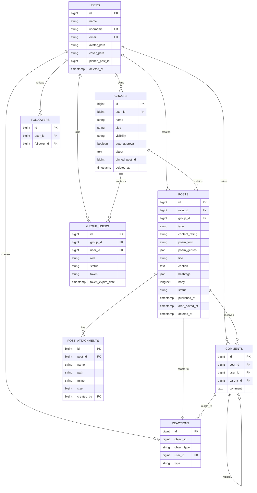

# Poet-Web ER Diagram

The following diagram focuses on the project-domain tables that are most useful in a qualification presentation. Framework/support tables are intentionally omitted.



## Important relationships to explain

### Users and publications

A user can create many publications.

A publication may be:

- a standalone public publication;
- a publication inside a group.

### Groups and memberships

`group_users` represents membership and stores:

- membership status;
- member/admin role;
- invitation token information.

The pair `group_id + user_id` is unique.

### Group visibility

`groups.visibility` is:

```text
public
private
```

Public group publications can be read by guests.

Private group publications require approved membership.

### Comments

Comments belong to both a user and a post.

`parent_id` is self-referencing, allowing replies/threading.

### Reactions

Reactions are polymorphic:

```text
object_type
object_id
```

This allows the same reaction table to support both posts and comments.

### Followers

The followers table represents user-to-user relationships:

```text
user_id
→ followed user

follower_id
→ user who follows
```

## Presentation advice

Use the diagram to explain relationships, not every field.

The most useful sequence is:

```text
users
→ posts
→ comments / reactions / attachments

users
→ group_users
→ groups
→ group posts
```

That is enough to show database depth without spending several presentation slides zooming into the same schema.
