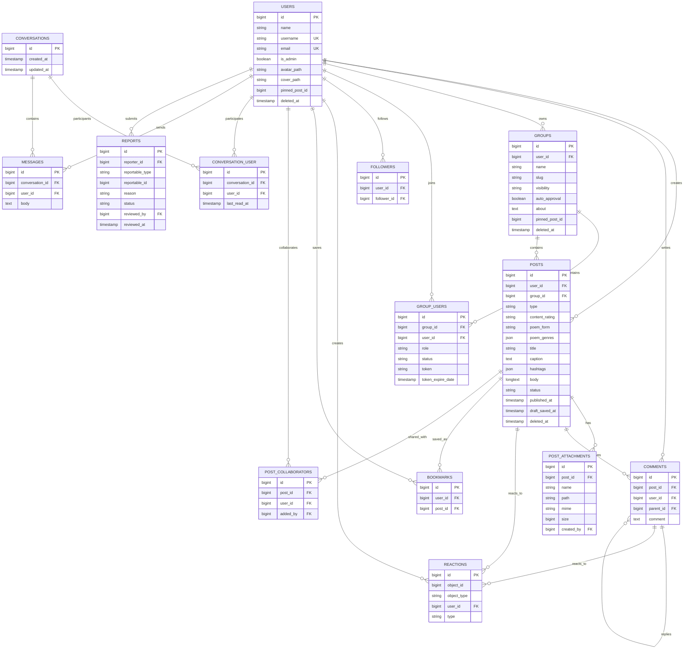

# Poet-Web ER Diagram

The following diagram focuses on project-domain tables that are useful in the qualification presentation. Laravel framework/support tables are intentionally omitted.



## Core relationships to explain

For the presentation, do not try to explain every line of the diagram.

### Publishing

```text
users
→ posts
→ comments / reactions / attachments
```

A publication may be standalone or belong to a group.

### Groups

```text
users
→ group_users
→ groups
→ group posts
```

`group_users` stores membership status/role.

Group visibility and membership approval are separate controls.

### Social reading

```text
users
→ followers

users
→ bookmarks
→ posts
```

Bookmarks are private reading-list entries.

### Collaborative drafts

```text
post
→ post_collaborators
→ users
```

The post owner stays the publishing authority while collaborators may edit/autosave an explicitly shared draft.

### Direct messages

```text
users
→ conversation_user
→ conversations
→ messages
```

`last_read_at` on the participant pivot supports unread counts.

### Moderation

Reports use:

```text
reportable_type
reportable_id
```

to identify a reported post/comment/user.

The report also stores the reporter and optional reviewing site administrator.

## Presentation advice

The main ER slide can emphasize only these areas:

```text
Users / Posts
Groups / Membership
Comments / Reactions
Bookmarks
Messages
Reports
```

Keep the complete diagram available for questions, but do not spend several slides zooming into every field.
